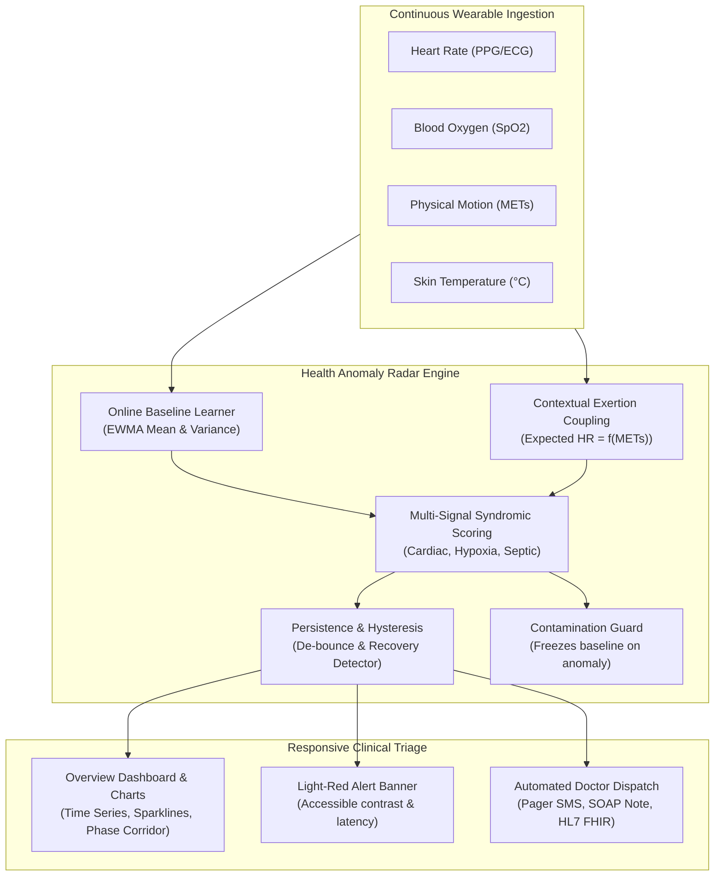

# Real-Time Wearable Health Anomaly Radar
> **Production-Quality Clinical Telemetry Dashboard with Unsupervised Multi-Signal Deviation Scoring & Emergency Dispatch**

---

## 1. Executive Summary & Design System

The **Wearable Health Anomaly Radar** is a clinical-grade physiological surveillance platform designed to combat alarm fatigue in continuous wearable monitoring. While conventional wearables rely on static single-signal cutoffs (e.g. arbitrary $HR > 100\text{ bpm}$ thresholds), this system couples multi-channel biometrics—**Heart Rate (bpm)**, **Pulse Oximetry ($SpO_2\ \%$)**, **Physical Exertion (METs)**, and **Skin Temperature (°C)**—to distinguish between healthy physical exertion and life-threatening medical emergencies.

### Visual Identity & Design System
- **Main Background**: `#F4F7FB` (soft cool-gray light healthcare surface)
- **Primary Surfaces**: `#FFFFFF` (subtle glassmorphism with 14–20px corner radii and low-opacity borders)
- **Sidebar & Deep Headings**: `#263858` (authoritative deep navy)
- **Primary Accent & Actions**: `#168C83` (clinical medical teal)
- **Secondary Blue**: `#4776B9` (activity and telemetry blue)
- **Warning Indicator**: `#E5A33D` (amber)
- **Critical Emergency**: `#D9364F` (coral red, reserved exclusively for critical conditions)
- **Text Hierarchy**: Main `#182338`, Secondary `#64748B`, Borders `#DFE6EF`
- **Surface Proportions**: ~70% light neutral surfaces, ~20% deep navy/indigo elements, ~10% clinical accents
- **Typography**: Inter with tabular numerals (`tabular-nums`) for high-frequency telemetry stability.

---

## 2. Application Structure & Views

The desktop interface features a **persistent sidebar** with a product logo, live device connection status (Polar H10 BLE, battery, drop rate), sandbox indicators, and 9 primary views:

1. **Overview Dashboard**:
   - Page telemetry header with live sync indicator and patient demographics.
   - 4 Live Vital Cards: Heart rate, SpO2, Activity, and Skin Temperature—each featuring current measurement, unit, learned baseline range, trend indicator, high-DPI historical sparkline, and freshness timestamp.
   - Continuous Multi-Signal Telemetry Chart with 1m, 5m, and 1h time-range selectors, interactive signal isolation toggles (HR, SpO2, Act, Temp), and visible red/amber anomaly event markers.
   - Learned Personal Baseline summary card with real-time learning progress bar (0–100%) and scientific explanation.
   - Audited Recent Events table with measured detection latency and one-click operator acknowledgment.
   - Quick Deterministic Scenario Injection bench.
2. **Live Monitoring**: High-frequency 60fps Lead-I ECG rhythm strip, PPG signal quality index (99.4%), BLE connection telemetry, and stale-data watchdog.
3. **Anomaly Radar**: 
   - 2D Phase-Space Exertion Corridor ($HR\text{ vs. METs}$) comparing the normal exertion envelope against the upper-left Silent Cardiac Danger Zone.
   - Multi-Axis Anomaly Radar Decomposition (HR excess, SpO2 deficit, exertion mismatch, temp shift).
   - Clinical explainability narrative explaining *why* the reading is unusual without black-box probabilities.
4. **Personal Baseline**: Detailed breakdown of online statistical baselines ($\mu \pm 2\sigma$), profile presets (Standard Adult, Athlete, Elderly/COPD), and contamination freeze guards.
5. **Event History**: Comprehensive clinical audit trail with severity filtering, duration, and latency benchmarks.
6. **Doctor Alerts**: Physician dispatch preview for *Dr. Aris Thorne, MD*, including instant pager text, clinical SOAP note, HL7 FHIR v4.0.1 payload, and one-click copy functionality.
7. **Simulator Bench**: Deterministic scenario inject bench, manual sliders, Emergency Health Spike button, and real-time measured latency inspector.
8. **Analytics**: Circadian baseline tracking, resting HR stability, and sensor uptime metrics.
9. **Settings**: Configurable thresholds (Critical 7.0, Warning 4.5, persistence window, hysteresis cooldown).

---

## 3. Mathematical & Clinical Architecture



### Key Algorithmic Highlights
1. **Activity-Exertion Coupling (The Workout Test)**:
   $$\text{HR}_{\text{expected}} = \mu_{\text{resting}} + (\text{METs} \times 11.5)$$
   Elevated heart rates during exercise are physiologically matched, suppressing false alarms.
2. **Baseline Contamination Protection**:
   When an active emergency occurs, baseline learning is immediately frozen to prevent pathological states from shifting normal baseline parameters.
3. **Sub-Second Measured Detection Latency**:
   Latency is measured dynamically as $\Delta t = t_{\text{detection\_complete}} - t_{\text{ingest}}$ (strictly non-hardcoded).
4. **Physiological Hysteresis & Recovery**:
   Alerts require 6 consecutive stable cycles before transitioning into a confirmed `RECOVERY_RESOLVED` event, preventing oscillation.

---

## 4. Verification & Automated Test Suite

An automated test suite is integrated in `tests/test_runner.html` and `backend/test_detector.py` covering:

1. **Unsupervised Baseline Online Adaptation**: Confirms dynamic learning of patient mean ($\mu$) from clean data.
2. **Silent Cardiac Spike (160 bpm @ 0.2 METs)**: Validates immediate Red Alert triggering.
3. **Exertion Gating (Workout Test)**: Asserts that HR 154 bpm at 8.4 METs is recognized as normal exercise (0 false alarms).
4. **Acute Hypoxemia with Reflex Tachycardia**: Validates respiratory distress classification when SpO2 drops to 85.5%.
5. **Sensor Noise & Motion Artifact Filter**: Verifies single-tick optical dropouts are rejected without raising red alarms.
6. **Baseline Contamination Guard**: Verifies baseline mean does not drift during sustained emergency spikes.
7. **Duplicate Event Suppression**: Verifies continuous emergency updates duration rather than flooding duplicate events.
8. **Physiological Hysteresis & Recovery**: Verifies automatic resolution and recovery logging once vitals normalize.
9. **Measured Detection Latency**: Validates non-zero, measured pipeline latency ($>0\text{ ms}$).

---

## 5. Execution & Demonstration Instructions

### Method A: One-Click Launch (Browser Standalone)
Double-click `run.bat` or run in PowerShell:
```powershell
powershell -ExecutionPolicy Bypass -File .\launch.ps1
```
This opens `index.html` in Microsoft Edge or the default web browser.

### Method B: Lightweight Local HTTP Server
Run the built-in PowerShell web server:
```powershell
powershell -ExecutionPolicy Bypass -File .\server.ps1 -Port 8080
```
Navigate to: `http://localhost:8080/`

### Method C: Running the Automated Test Suite
Open the test suite directly in the browser:
```powershell
Start-Process "file:///$((Get-Location).Path)\tests\test_runner.html"
```

### Method D: Optional Python FastAPI Backend
If Python with FastAPI/Uvicorn is available on your workstation:
```bash
cd backend
pip install -r requirements.txt
uvicorn main:app --reload --port 8000
```
The frontend automatically detects and binds to `ws://localhost:8000/ws/telemetry`.

---

## 6. Clinical Disclaimer & Limitations
- **Demonstration Sandbox**: All telemetry streams generated in this demonstration are synthetic approximations of human physiology for algorithmic testing.
- **Not a Diagnostic Medical Device**: This software is intended for research, clinical decision support benchmarking, and simulation. It has not received FDA 510(k) clearance or CE Mark certification.
